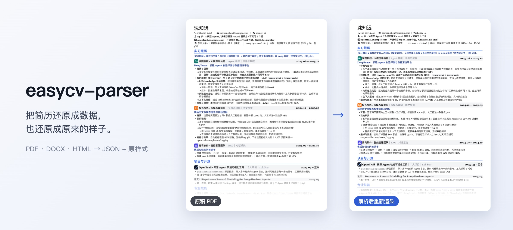

# easycv-parser

### Turn a resume into data — and back into the way it looked.

[](#quick-start)

<p align="center">
  <a href="#quick-start">Quick start</a> ·
  <a href="docs/how-it-works.md">How it works</a> ·
  <a href="docs/data-model.md">Data model</a> ·
  <a href="README.md">简体中文</a>
</p>

<p align="center">
  <a href="LICENSE"></a>
  <a href="https://github.com/ZihanDaiii/easycv-parser/actions/workflows/ci.yml"></a>
  
  
</p>

easycv-parser is an open-source resume parsing engine. It reads resumes in PDF, Word (.docx) or HTML and produces structured data: header, sections, entries, bullet points and tables, together with the original fonts, colors and layout.

Unlike parsers that only extract text, it recovers both the **content** and the **look**. The result can be rendered again in the original style, and it comes out nearly identical.

Everything runs in the browser, so files never leave the user's device. It is also the parsing engine behind EasyCV.

## See it in action

Left: the original PDF. Right: the same resume parsed into structured data and rendered again. All people, schools and companies in the sample are fictional.


## Philosophy

- **Structure and style matter equally**
  - Layout is information. Fonts, accent colors, section-heading styles and two-column layouts are detected and kept.
  - Content and style are stored separately, so either one can be used or replaced on its own.

- **No fixed fields**
  - Entries are not forced into "company / title / dates". Each line is kept as written: rich text plus an optional right-aligned part.
  - Any resume can be preserved completely, with nothing dropped for not fitting a schema.

- **One pipeline, many formats**
  - PDF, DOCX and HTML are converted into one intermediate representation and share the same layout analysis and structure recognition.

- **Local first**
  - No server, no network requests. Resumes are highly personal data and should stay on the user's device.

## What it does

- **Recognizes structure.** Header (name, contacts, photo), section titles, entry titles with right-aligned dates, nested bullet points, tables.
- **Recovers layout.** Single and two-column layouts, margins, spacing, indentation, alignment, header placement.
- **Recovers style.** Latin and CJK fonts, sizes, bold and italic, accent color, section-heading styles, color blocks, rules, list markers.
- **Keeps images.** Photos, company logos and vector icons.
- **Renders it back.** A read-only React component draws the result in its original style.

Optimized for Chinese resumes and works with English ones. Scanned or image-only PDFs need OCR first.

## Quick start

Run the playground locally:

```bash
git clone https://github.com/ZihanDaiii/easycv-parser.git
cd easycv-parser
npm install
npm run dev
```

Open <http://localhost:5190> and click the sample button, or drop in your own resume.

### Use it in your project

```ts
import { configurePdfjs, parseResume } from 'easycv-parser';
import workerUrl from 'pdfjs-dist/build/pdf.worker.min.mjs?url';

// CJK PDFs need pdf.js character maps: serve node_modules/pdfjs-dist/cmaps as static files
configurePdfjs({ workerSrc: workerUrl, cMapUrl: '/pdfjs/cmaps/', standardFontDataUrl: '/pdfjs/standard_fonts/' });

const { resume, stats } = await parseResume(file);
```

```tsx
import { ResumeView, RESUME_CSS } from 'easycv-parser/render';

<>
  <style>{RESUME_CSS}</style>
  <ResumeView doc={resume} />
</>
```

The npm package is coming soon. For now, build from source with `npm run build`.

## How it works

```text
source ──▶ extract           text, fonts, colors, fills, rules, markers, images
       ──▶ layout analysis   columns, lines, paragraphs, lists, alignment, tables
       ──▶ structure         header, sections, entries, dates, bullets
       ──▶ style             fonts, sizes, accent color, heading styles, margins
       ──▶ Resume JSON
```

See [How it works](docs/how-it-works.md) and [Data model](docs/data-model.md) (in Chinese).

## Repository layout

```text
src/parser/     # extraction (pdf / html / docx), layout analysis, structure and style recovery
src/model/      # data types
src/render/     # read-only renderer
playground/     # demo page
examples/       # sample resume (fictional)
docs/           # internals and data model
```

## Development

```bash
npm run dev
npm run typecheck
npm run build
npm run smoke       # needs `npm run dev` running and Chrome installed
```

Please use fictional content in issues and test fixtures. Never upload a resume with real personal information.

## Security

Report vulnerabilities privately through [GitHub Security Advisories](https://github.com/ZihanDaiii/easycv-parser/security/advisories/new). See [SECURITY.md](SECURITY.md).

## License and contributions

The original code is licensed under [AGPL-3.0-only](LICENSE). Third-party components keep their own licenses.

Contributions require signing the [CLA](CLA.md). See [CONTRIBUTING.md](CONTRIBUTING.md).
