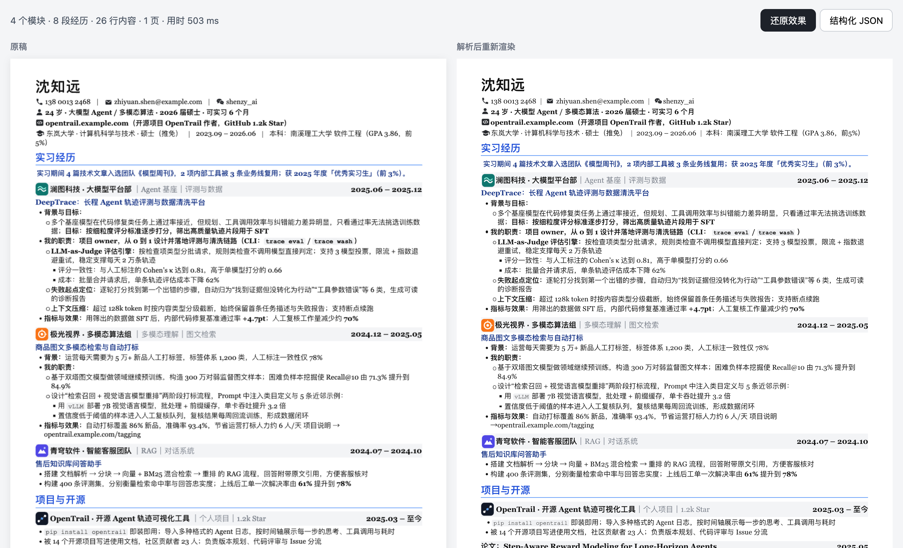

# easycv-parser

把 PDF / Word（.docx）/ HTML 简历还原成**结构化数据**，同时还原原稿的**版式和样式**。纯前端，文件不出浏览器。

[English](#english) · [效果](#效果) · [快速开始](#快速开始) · [API](#api) · [原理](docs/how-it-works.md) · [数据格式](docs/data-model.md)

> 本项目是简历编辑产品「简单简历 EasyCV」的解析引擎开源版。

## 效果

左边是原稿 PDF，右边是解析成结构化数据之后**重新渲染**出来的结果（示例简历中的人物、学校、公司均为虚构）：



| 能识别的 | 说明 |
|---|---|
| 结构 | 页眉（姓名、联系方式、照片）、模块（教育 / 实习 / 项目……）、经历（标题 + 右侧时间）、多级要点、表格 |
| 版式 | 单栏 / 左右两栏、页眉位置、页边距、段落间距、缩进、对齐 |
| 样式 | 中英文字体、字号、粗体 / 斜体、主题色、模块标题样式（色带、下划线、色块……）、背景色块、分隔线、列表符号 |
| 图片 | 证件照、公司 Logo、图标等内嵌图形 |
| 格式 | PDF（文字版）、Word .docx、HTML |

不支持：扫描件 / 图片 PDF（需要先 OCR）、旧版 .doc。

## 快速开始

### 在线演示（本地运行）

```bash
git clone https://github.com/ZihanDaiii/easycv-parser.git
cd easycv-parser
npm install
npm run dev        # http://localhost:5190 ，点「用示例简历试试」或拖入自己的简历
```

### 在项目里使用

> npm 包即将发布，目前可以直接从源码构建：`npm run build` 生成 `dist/`。

```ts
import { configurePdfjs, parseResume } from 'easycv-parser';
import workerUrl from 'pdfjs-dist/build/pdf.worker.min.mjs?url'; // Vite 写法；其他打包工具按各自方式拿到 worker 地址

// 中文 PDF 需要 pdf.js 的字符映射表（cmaps），把 node_modules/pdfjs-dist/cmaps 放到静态目录下
configurePdfjs({ workerSrc: workerUrl, cMapUrl: '/pdfjs/cmaps/', standardFontDataUrl: '/pdfjs/standard_fonts/' });

const { resume, stats } = await parseResume(file); // file 来自 <input type="file">
console.log(stats);          // { sections: 4, entries: 8, lines: 26 }
console.log(resume.body);    // 模块 → 经历 → 段落 的树
```

按原样式渲染（React，可选）：

```tsx
import { ResumeView, RESUME_CSS } from 'easycv-parser/render';

<>
  <style>{RESUME_CSS}</style>
  <ResumeView doc={resume} />
</>
```

## API

| 函数 | 说明 |
|---|---|
| `parseResume(input, { kind? })` | 一步到位：`File` / `Blob` / `ArrayBuffer` → `{ resume, stats, extracted }`。`kind` 为 `'pdf' \| 'docx' \| 'html'`，传 `File` 时可省略 |
| `extract(data, kind)` | 只做第一步：读出文字片段、字体、颜色、色块、线条、图片（`Extracted`） |
| `buildResume(extracted)` | 只做后两步：版面分析 + 结构识别 + 样式还原 |
| `configurePdfjs({ workerSrc, cMapUrl, standardFontDataUrl })` | 设置 pdf.js 资源位置 |
| `detectKind(name, mime)` | 按文件名 / MIME 判断格式 |
| `ResumeView`、`RESUME_CSS`（`easycv-parser/render`） | 把 `resume` 按原稿样式渲染出来（只读） |

出错时抛出 `ParseError`，`code` 为 `unsupported`（格式不支持）或 `no_text`（没有文字层，多半是扫描件）。

## 原理

```
原稿 ──▶ 提取（pdf.js 取字 + 页面位图分析颜色、色块、线条、符号、图片）
     ──▶ 版面分析（分栏、行、段落、列表、对齐）
     ──▶ 结构识别（页眉、模块标题、经历、时间、要点、表格）
     ──▶ 样式还原（字体、字号、主题色、模块标题样式、边距）
     ──▶ Resume JSON
```

详见 [docs/how-it-works.md](docs/how-it-works.md)，数据格式见 [docs/data-model.md](docs/data-model.md)。

## 这个仓库包含什么、不包含什么

| 开源（本仓库） | 不在本仓库（属于「简单简历」产品） |
|---|---|
| PDF / Word / HTML 解析引擎 | 在线编辑器（拖拽排序、改样式、模板、适配页数……） |
| 结构化数据格式（类型定义） | 导出 PDF / HTML |
| 只读渲染组件 | 账号、云端保存、会员与支付 |
| 演示页、示例简历、测试脚本 | AI 辅助识别（本地识别不完整时的兜底） |

想直接在网页上修改并导出简历，可以使用「简单简历 EasyCV」产品。

## 隐私

解析全部在浏览器里完成，本库不会发起任何网络请求（pdf.js 的 worker 和字符表除外，由你自己托管）。

**提 Issue 时请不要上传含真实个人信息的简历**，用虚构内容复现问题即可，见 [CONTRIBUTING.md](CONTRIBUTING.md)。

## 参与贡献

欢迎提 Issue 和 PR，特别是：识别出错的简历版式（请用虚构内容复现）、新的模块标题写法、英文简历。见 [CONTRIBUTING.md](CONTRIBUTING.md)。第一次提 PR 时需要签署[贡献者许可协议（CLA）](CLA.md)，机器人会在 PR 里提示，回复一句话即可。

## 许可证

代码以 [GNU AGPL-3.0](LICENSE)（`AGPL-3.0-only`）开源：

- 个人学习、研究、自己内部使用：随意使用和修改。
- 把本项目（或改过的版本）集成进你的产品并**分发**，或者**作为线上服务提供给别人使用**：需要按 AGPL-3.0 把你的完整源代码同样开源。
- 想闭源商用：可以向项目所有者申请**商业授权**，在 GitHub 上联系 [@ZihanDaiii](https://github.com/ZihanDaiii)。

「简单简历」「EasyCV」名称和 Logo 不在授权范围内，见 [NOTICE](NOTICE)。

---

## English

**easycv-parser** turns PDF / Word (.docx) / HTML resumes into structured JSON **and** recovers the original layout and styling (fonts, colors, section-heading styles, two-column layouts, photos, tables). It runs entirely in the browser. It is the open-source parsing engine behind the EasyCV resume editor; the editor, export, accounts and AI fallback are not part of this repository.

```bash
npm install && npm run dev   # open http://localhost:5190 and click the sample button
```

```ts
const { resume, stats } = await parseResume(file);
```

Optimized for Chinese resumes, works with English ones. Licensed under AGPL-3.0-only (commercial licenses available from the project owner); contributions require signing the [CLA](CLA.md). The "EasyCV" name and logo are not covered by the license.
